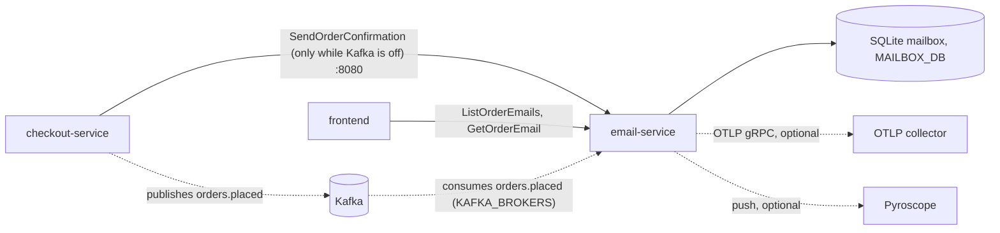
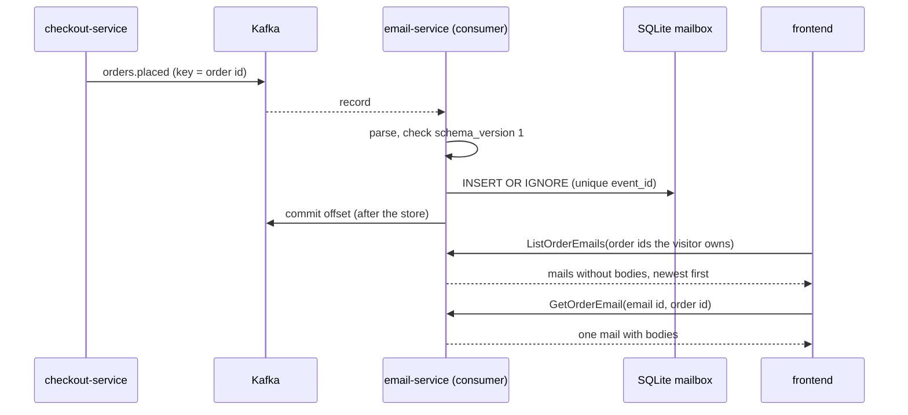

# Architecture

## Context

email-service sends no real mail: no SMTP and no provider. It renders the order-confirmation template and, on the Kafka path, stores the mail in a SQLite file that the frontend reads through `MailboxService` on the same port. It calls no other service. The callers are taken from the README ("Called by"); `checkout-service` publishing the event and calling `SendOrderConfirmation` was checked in its `origin/main` code on 2026-11-21, the frontend's use of the mailbox RPCs too (`ListOrderEmails`, `GetOrderEmail` in `cmd/server/mailbox.go`).

## The two paths

| | Direct path | Kafka path |
|---|---|---|
| Switch | always there | `KAFKA_BROKERS` set |
| Trigger | `EmailService/SendOrderConfirmation` from checkout, which calls it only while Kafka is off | `orders.placed` event |
| What happens | the template is rendered to prove the order data is valid, the request is logged | rendered (HTML and plain text), stored in the mailbox, logged, offset committed |
| Mailbox | nothing written | one row per `event_id` |

## Components

| File | Role |
|---|---|
| `src/server.py` | gRPC server (10-thread pool) with `EmailService`, `MailboxService` and `Health` on one port, reflection, SIGTERM handling |
| `src/consumer.py` | the `orders.placed` consumer (`kafka-python`): parse and skip rules, retries, manual commit |
| `src/rendering.py`, `templates/` | Jinja2 rendering shared by both paths (HTML and plain-text twin) |
| `src/mailbox_store.py`, `src/mailbox_service.py` | the SQLite mailbox (stdlib `sqlite3`, WAL, one lock, versioned migrations) and the `MailboxService` servicer |
| `src/telemetry.py`, `logsetup.py`, `kafka_trace.py`, `runtime_metrics.py` | telemetry contract, JSON logs, trace context from Kafka headers, Python runtime metrics |
| `proto/` | `email.proto`, `mailbox.proto`, `health.proto`; the stubs are generated in the Docker build, not committed |

## Decisions

[ADR 1](adr/0001-sqlite-mailbox.md), [ADR 2](adr/0002-commit-after-store-idempotent-by-event-id.md).
