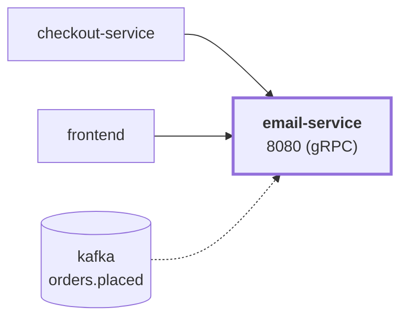

# email-service

service · platform-demo

A gRPC service that handles order-confirmation emails for the platform-demo e-commerce platform. **It still sends no real email** (no SMTP, no provider). It does two things:

1. **Kafka path (new, optional):** with `KAFKA_BROKERS` set it consumes `order.placed` events from the topic `orders.placed`, renders the order-confirmation template, logs that a confirmation was "sent" and **stores the mail in a SQLite mailbox** (`MAILBOX_DB`). The mailbox is readable through a second gRPC service, `hipstershop.mailbox.MailboxService`, on the same port (the frontend shows it under `/emails`).
2. **Direct path (unchanged):** `EmailService/SendOrderConfirmation`, used by `checkout-service` while Kafka is off: renders the template to prove the order data is valid, logs the request, writes nothing to the mailbox.

With `KAFKA_BROKERS` empty (the default) the service behaves as before; the mailbox is then simply empty.

Runtime<strong>Python 3.12</strong><small>Python</small>

Listens on<strong>8080</strong><small>gRPC</small>

State<strong>Stateless</strong>

Image<strong>email-service</strong><small>mladenovskistefan/</small>

## Where it sits

Called by `checkout-service` (direct path) and `frontend` (mailbox); consumes the Kafka topic `orders.placed`. It calls no other service.

## At a glance

| | |
|---|---|
| **Language / runtime** | Python 3.12 in the image (3.13 pinned for local dev), `grpcio`, Jinja2, `kafka-python` (pure Python), stdlib `sqlite3` |
| **Image** | `mladenovskistefan/email-service` |
| **Protocol / port** | gRPC (HTTP/2, plaintext) on `8080` |
| **Metrics** | Pushed over OTLP/gRPC to Alloy → Mimir every 15 s (no scrape endpoint). Dashboard names: `rpc_server_duration_seconds_{bucket,count,sum}`, `rpc_server_requests_total`, `rpc_server_active_requests` |
| **Health** | `grpc.health.v1.Health/Check` on `8080` — static `SERVING` |
| **State** | SQLite mailbox file `MAILBOX_DB` (default `/data/mailbox.db`, WAL; a volume in compose). Empty and unused while Kafka is off |
| **Depends on** | Optional: Kafka (`KAFKA_BROKERS`, topic `orders.placed`), OTLP collector, Pyroscope. The service starts, answers and stays healthy without any of them |
| **Called by** | `checkout-service` (`SendOrderConfirmation`, only while Kafka is off), `frontend` (`MailboxService`). Consumes `orders.placed` (published by checkout) |
| **gRPC reflection** | Not enabled (as before; the contract's "reflection as today" means none) — pass `-proto` to `grpcurl` |

## Find it elsewhere

<h4><a href="https://argocd.platform-demo.click/applications/argocd/dev-email-service">Argo CD</a></h4>
Sync and health of <code>dev-email-service</code>.

<h4><a href="https://grafana.platform-demo.click/d/email-service-overview">Grafana</a></h4>
Latency, traffic and errors (<code>email-service-overview</code>).

<h4><a href="https://github.com/platform-boutique/app-email-service">Repository</a></h4>
Source and pull requests of <code>app-email-service</code>. Images are published from <code>main</code> by the Publish workflow; there are no releases or tags in this repository.

!!! info "Part of the platform-demo platform"
    Cross-cutting facts (service wiring, observability contract, Kubernetes translation, CI/CD) are in the
    [master reference](https://github.com/platform-boutique/platform-demo-docs). This site only describes email-service.
